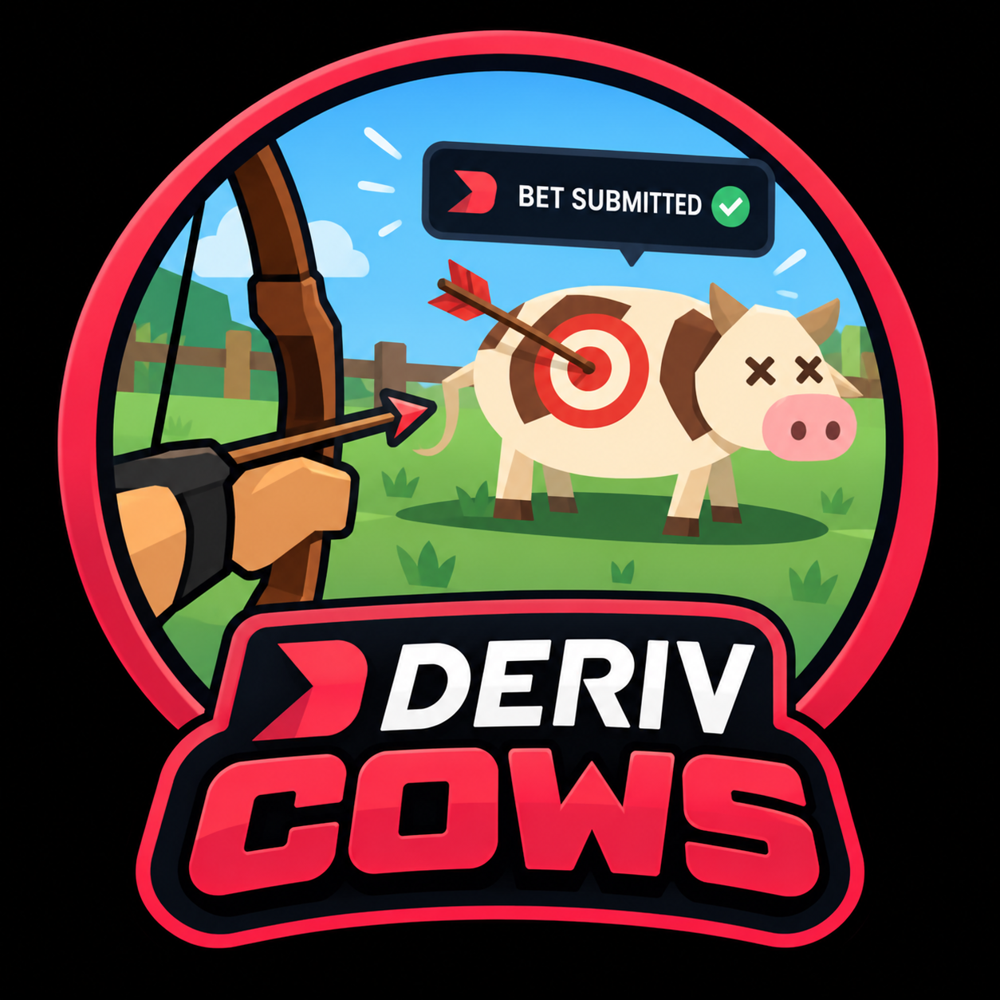
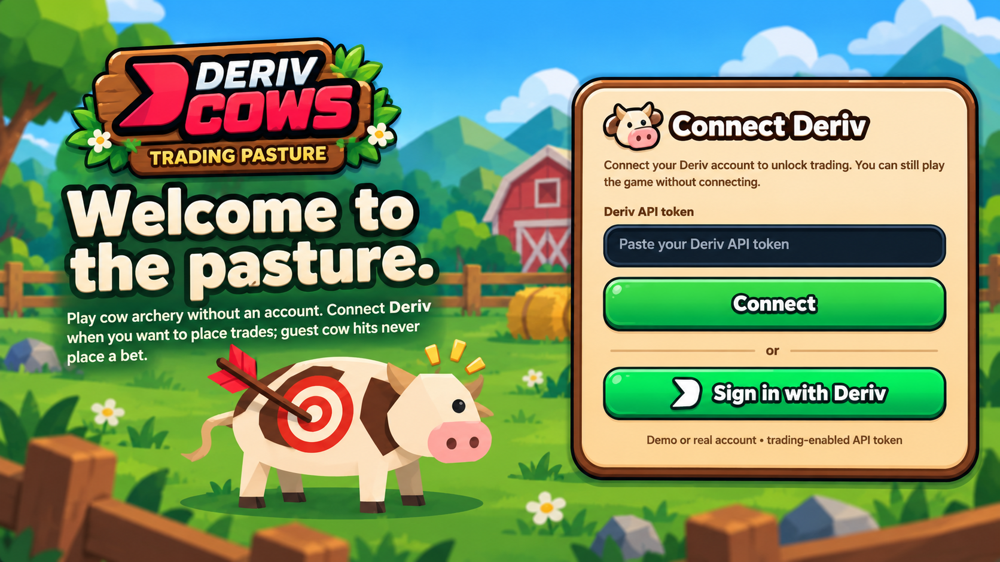
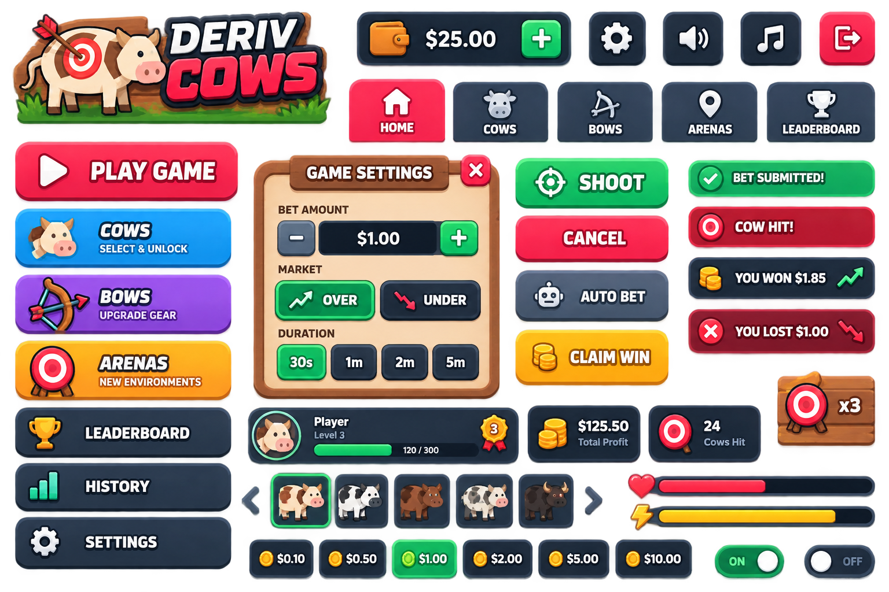

# DERIV COWS

<div align="center">


### AIM. SHOOT. TRADE.

**A strategy-driven archery trading game built around discipline, market selection, and time management.**

[PLAY DERIV COWS](https://derivcows.up.railway.app/) | [ENTER THE ARCHERY ROOM](https://derivcows.up.railway.app/trading-room.html)

</div>

---

## ABOUT DERIV COWS

<div align="center">



</div>

**Deriv Cows** is an interactive, browser-based archery game that combines cow-hunting gameplay with Deriv synthetic indices trading.

The project was created to address three common challenges faced by traders: **overtrading, poor time management, and inconsistent trading discipline.**

Instead of continuously watching charts or entering trades impulsively, players enter a virtual pasture where they control a ranger, aim at cows, and participate in a structured trading experience.

Unlike conventional automated trading systems, Deriv Cows encourages players to develop their own strategies by choosing the appropriate market, identifying suitable trading times, and recognizing when it is better not to trade.

The result is a game that combines entertainment, strategic decision-making, and trading functionality in a single interactive environment.

---

## THE GAME EXPERIENCE

### Enter the Pasture

<div align="center">



</div>

Deriv Cows introduces players to a pasture-themed environment designed to make the trading experience more interactive and engaging.

Players can enter the game, explore the pasture, and practise archery without connecting a trading account.

Connecting an authorized Deriv account provides access to eligible trading functionality, subject to the application's configuration and risk-management controls.

### Archery Gameplay

Players take control of a ranger equipped with a bow and arrow.

The gameplay experience includes:

- Ranger movement and positioning.
- Interactive cow targets.
- Bow-and-arrow shooting mechanics.
- Experience points and progression indicators.
- Desktop and mobile-friendly controls.
- Adjustable game view and zoom.
- Trading and gameplay status feedback.

The archery environment provides the main interaction, while the trading system manages eligible contract requests and execution.

---

## CORE FEATURES

### 1. Overtrading Prevention

One of the main objectives of Deriv Cows is to discourage excessive and impulsive trading.

The application incorporates trading cooldowns and execution controls that introduce structured pauses between eligible trading opportunities.

These mechanisms are intended to help players:

- Reduce repetitive trading decisions.
- Avoid immediately entering another trade after a loss.
- Become more selective about trading opportunities.
- Exercise patience between trades.
- Maintain greater awareness of their trading activity.

Deriv Cows promotes the principle that **more trades do not necessarily mean better trading.**

### 2. Time Management

Deriv Cows is designed to encourage better management of the time and attention players dedicate to trading.

Traditional trading interfaces can encourage prolonged chart-watching and frequent trade entry. Deriv Cows introduces a gameplay environment that changes how players interact with the market.

Rather than continuously searching for another trade, players can engage with the archery environment while observing the application's trading rules and cooldowns.

The goal is to promote a more balanced and structured trading experience.

### 3. Player-Developed Trading Strategies

Strategy development is a central part of Deriv Cows.

Players are encouraged to make informed decisions about **which market to trade, when to trade, and when to remain inactive.**

The game allows players to approach trading strategically instead of treating every available opportunity as a reason to enter a position.

Key strategic considerations include:

**Market Selection**

Choose a synthetic index that aligns with the player's preferred trading approach.

**Trade Timing**

Identify suitable trading periods based on observed market behaviour and personal strategy.

**Strategy Development**

Experiment with market choices, trading approaches, and timing to refine individual strategies.

**Risk Awareness**

Consider trading conditions, potential losses, and cooldown restrictions before participating.

**Performance Evaluation**

Review trading results and use previous outcomes to assess trading decisions.

**Knowing When Not to Trade**

Recognize unsuitable conditions and avoid unnecessary trades.

The objective is to help players develop a more deliberate approach to market participation.

---

## HOW DERIV COWS WORKS

**Step 1 — Enter the Game**

Launch Deriv Cows and access the interactive pasture.

**Step 2 — Select a Market**

Choose the Deriv synthetic index that aligns with your intended trading strategy.

**Step 3 — Evaluate the Timing**

Observe the market and decide whether the current conditions are suitable for your approach.

**Step 4 — Aim and Shoot**

Control your ranger, aim at a cow, and fire an arrow.

**Step 5 — Trading Integration**

When trading is enabled, eligible gameplay actions may initiate a Deriv digit-contract request, subject to authorization, configured rules, and risk checks.

**Step 6 — Observe Cooldowns**

Follow the application's trading cooldowns and execution restrictions before taking another eligible trade.

**Step 7 — Review and Refine**

Monitor recent trade performance and use the results to evaluate your strategy.

---

## USER INTERFACE AND VISUAL DESIGN

<div align="center">



</div>

Deriv Cows features a custom interface built around its pasture and archery theme.

The visual design aims to keep gameplay as the central focus while making trading information accessible.

Interface elements include:

- Ranger status and experience indicators.
- Game movement and shooting controls.
- Market selection and trading information.
- Deriv connection status.
- Trading cooldown feedback.
- Trade execution notifications.
- Recent trade performance.
- Responsive desktop and mobile layouts.

### Branding

**Primary Game Icon**

<div align="center">


</div>

The favicon represents the compact identity of Deriv Cows and is used for browser and application recognition.

**Detailed Game Logo**

<div align="center">


</div>

The detailed logo expands on the primary icon and serves as the main visual branding for the project.

---

## TRADING INTEGRATION

Deriv Cows integrates with the Deriv API to provide account connectivity and synthetic indices trading functionality.

The trading infrastructure supports:

- Deriv account authentication.
- Synthetic indices market connectivity.
- Digit Over/Under contracts.
- Trading configuration and market selection.
- Trade execution and status reporting.
- Cooldown and risk-management controls.
- Recent trade history and profit/loss monitoring.

Players may participate in archery gameplay without connecting a trading account.

Trading operations require appropriate authorization and remain subject to application safeguards and market availability.

---

## TECHNOLOGY STACK

| Component | Technology |
|---|---|
| Frontend | Preact, TypeScript, Vite |
| Styling | Tailwind CSS, CSS |
| Game Interface | HTML, CSS, JavaScript |
| Backend | Node.js, Fastify, TypeScript |
| Real-Time Communication | WebSockets |
| Trading Integration | Deriv API |
| Database | SQLite |
| Hosting | Railway |
| Version Control | GitHub |

The repository also contains additional trading infrastructure, including market analysis, strategy services, simulation tools, and a separate Gold trading module.

---

## PROJECT STRUCTURE

```text
zeronine/
|
|-- web/
|   |-- public/
|   |   |-- trading-room.html
|   |   |-- deriv-cows-favicon.ico
|   |   |-- deriv-cows-logo.png
|   |   |-- pasture-login-reference.png
|   |   |-- cow-ui-assets.png
|   |
|   |-- src/
|       |-- App.tsx
|       |-- realCowConsent.ts
|
|-- src/
|   |-- api/
|   |-- deriv/
|   |-- strategy/
|   |-- gold/
|
|-- tests/
|-- package.json
|-- railway.toml
|-- README.md
```

### Game Assets

| File | Purpose |
|---|---|
| `web/public/deriv-cows-favicon.ico` | Primary game icon |
| `web/public/deriv-cows-logo.png` | Detailed game logo |
| `web/public/pasture-login-reference.png` | Login-screen design reference |
| `web/public/cow-ui-assets.png` | Game interface artwork |
| `web/public/trading-room.html` | Interactive archery game |

---

## LOCAL DEVELOPMENT

### Requirements

- Node.js 24 or later
- npm
- Git

### Clone the Repository

```bash
git clone https://github.com/goatmouthmarket-cmyk/zeronine.git
cd zeronine
```

### Install Dependencies

```bash
npm install
```

### Configure the Environment

```bash
cp .env.example .env
```

Configure the required application settings and credentials.

Do not commit API credentials, authentication tokens, or other secrets.

### Build the Frontend

```bash
npm run build:web
```

### Start the Application

```bash
npm run dev
```

Open the dashboard:

`http://localhost:8010`

Open the archery game:

`http://localhost:8010/trading-room.html`

### Run Verification

```bash
npm run verify
```

---

## DEPLOYMENT

Deriv Cows is hosted on Railway.

**Live Application:** https://derivcows.up.railway.app/

**GitHub Repository:** https://github.com/goatmouthmarket-cmyk/zeronine

The project includes Railway deployment configuration for application startup and health monitoring.

Production credentials should be managed through environment variables rather than stored in the repository.

---

## TRADING RISK AND DISCLAIMER

Deriv Cows is designed to encourage disciplined trading behaviour through gameplay, strategic market selection, and structured trading cooldowns.

However, these features do not guarantee that users will avoid overtrading or financial losses.

Trading synthetic-index contracts carries financial risk. Successful archery gameplay does not guarantee profitable trading outcomes.

Players should understand the associated risks and consider practising with a demo account before using real funds.

Deriv Cows is an independently developed application integrating Deriv services and is not presented as an official Deriv product.

---

<div align="center">


### DERIV COWS

**AIM. SHOOT. TRADE.**

*Trade with discipline. Choose your market. Manage your time.*

[PLAY DERIV COWS](https://derivcows.up.railway.app/)

</div>
